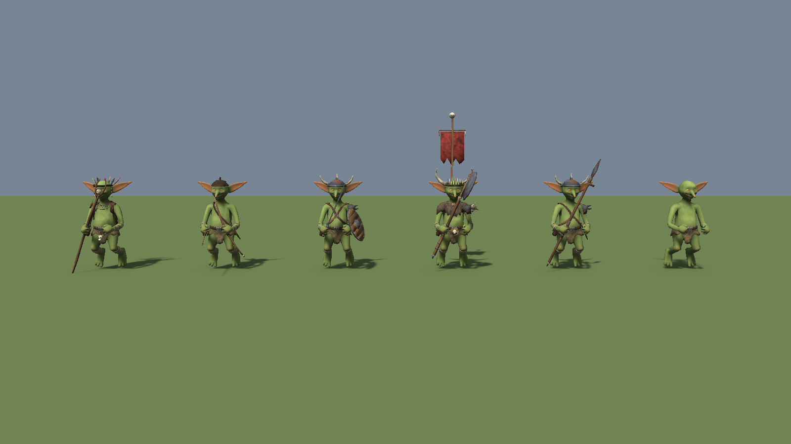
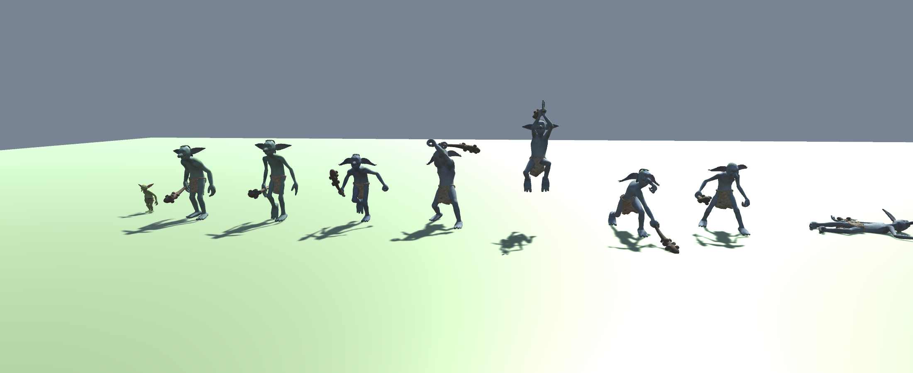
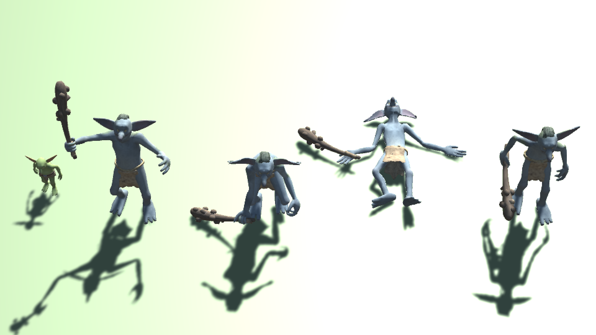
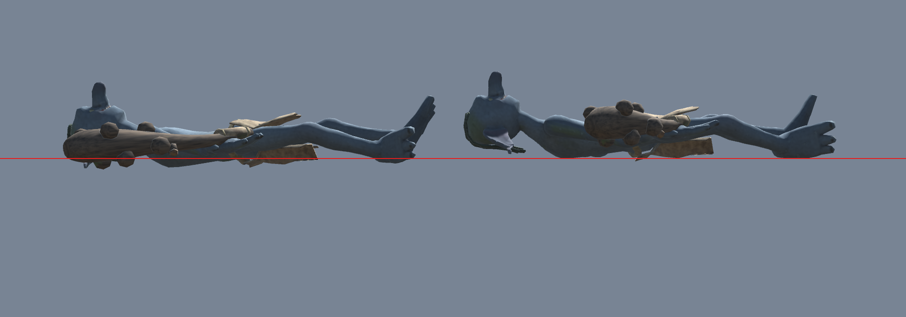
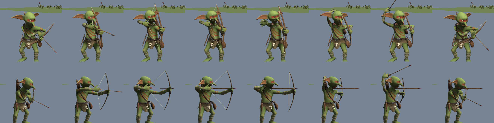
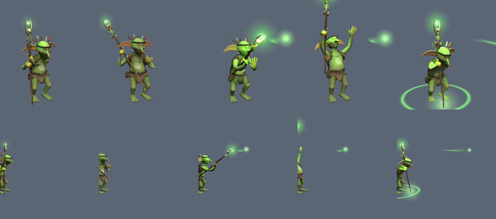

# Goblins

Generic goblin for the colony sim: procedural body, Unity-Humanoid rig in T-pose, hand-painted baked
textures, and modular gear. Props are separate objects on socket bones, not part of the body mesh, so every
goblin that shares this skeleton can carry any prop.



Blender file: `blender/goblins.blend`, scene **Goblin** (plus **Goblin_Archer** and **Goblin_Shaman** for the custom
clips, and **Goblin_Props**, a catalog). Everything in it is rebuilt from `src/`.

## Rebuild

In Blender (Python console or the MCP):

```python
import sys; sys.path.insert(0, r"E:\Unity\Projects\GameArtGeneration\Goblins\src")
import gob_build, gob_export
gob_build.build_all()      # body -> rig -> weights -> skin texture -> gear -> gear atlas (~25 s)
gob_export.export_all()    # export/Goblin.fbx, export/Props/*.fbx (the bakes are in textures/)

import gob_anim            # custom clips (the bow), authored on the rig
gob_anim.build_clips()     # actions Bow_Ready, Bow_Shoot, Bow_Volley
gob_anim.build_shaman_clips()   # Shaman_Idle, Shaman_Hex, Shaman_Chant
gob_anim.export_clips()    # export/Anims/Goblin@<clip>.fbx
gob_anim.clear()           # back to the T-pose before exporting the character again
```

| Script | Does |
|---|---|
| `gob_body.py` | Lofted limbs/torso, sculpted head (brow, sockets, grin, chin), cupped ears, nose, hands, feet; voxel-fused, symmetrised, decimated (head gets a larger share) |
| `gob_rig.py` | Armature (Unity Humanoid names), sockets, IK helpers, heat-map weights + smoothing, 4 influences max |
| `gob_paint.py` | Skin colours, AO and curvature painted on the dense mesh, baked to the game mesh; the mouth is painted per texel |
| `gob_gear.py` | Skinned outfits, socket props, painted source materials, one gear atlas |
| `gob_export.py` | FBX for Unity |
| `gob_anim.py` | Custom clips keyframed through the rig's IK and baked on export (the archer's and the shaman's) |
| `gob_crossbow.py` | Crossbow clips for the game's humans (scene **Goblin_Crossbow**), posed from the weapon kit's crossbow |
| `troll_body.py`, `troll_paint.py`, `troll_gear.py`, `troll_build.py` | The troll, grown from the goblin's builders (see **Troll** below; `blender/troll.blend`, run by `tools/troll_run.py`) |
| `troll_anim.py` | The troll's own clips (Roar, ClubDrag), posed through its IK with the hands placed by comfort |

## Budget (colony camera, ~40 m at 50°, no LODs)

| Part | Triangles |
|---|---|
| GoblinBody (incl. eyes) | 3,634 |
| Outfit_Loincloth / Harness / Wraps | 636 / 928 / 960 |
| Weapons: Spear, Glaive, Sword, Cleaver, Axe, Club | 456, 416, 400, 244, 336, 266 |
| Shields: round, plank | 676, 240 |
| Head: Helmet, PotHelm, LeatherCap, Hair | 762, 256, 458, 256 |
| Pauldron, Pouch, Knife, Waterskin, Sack, Necklace, SkullTrophy | 236, 202, 240, 198, 504, 368, 264 |
| Archer: Shortbow, Arrow, Quiver | 270, 134, 542 |
| Shaman: Staff, Headdress, Outfit_ShamanCloak | 732, 860, 1,080 |
| **A heavily kitted goblin** | **~9,000** |

Textures:
- `T_Goblin_Skin`, `T_Goblin_Skin_Warpaint`, `T_Goblin_Skin_Chief` and `T_Goblin_Skin_Shaman`, 1024².
- `T_Goblin_Gear`, 2048²; it holds all 29 props and the outfits.

UVs are laid out on purpose, not by Blender's automatic projection:
- **Body** (`gob_paint.unwrap`): cut along natural seams (down the back of trunk and head, under the arms, inside
  the legs, around hands, fingers, feet, ears and eyes), unfolded angle-based, one texel density, the face and eyes
  enlarged.
- **Gear:** every building block in `gob_common` / `gob_gear` (tubes, rings, straps, slabs, boxes, capes) writes its
  own UVs as it is built. `bake_gear` only evens out the density and packs.
- **Gutters:** after each bake, the empty space between pieces is filled with the nearest piece's colour
  (`fill_gutters`), so mip-maps at colony distance never pull black into the edges.

Two materials per goblin (skin and gear). Segment counts for the gear are scaled in one place (`SEG_SCALE` in
`gob_gear.py`); the body budget is `build_all(body_tris=...)`.

Blender: the **Goblin_Props** scene is a catalog of every prop (`gob_catalog.build_catalog()`). The Goblin scene
shows the spearman loadout; the other props are hidden there.

Body shape keys (Unity blend shapes):
- `Fat` and `Skinny`: belly, limbs, neck. The outfits carry matching keys (`gob_shapes.py`).
- `EarsDroop`, `EarTornL`, `EarTornR`.

## Skeleton

Hips, Spine, Chest, UpperChest, Neck, Head, Jaw (unweighted), Left/RightEye, Left/RightEar01-02 (ear flop),
Left/Right Shoulder, UpperArm, LowerArm, Hand, Thumb/Index/Middle/Ring x3, UpperLeg, LowerLeg, Foot, Toes,
under a `Root`. 52 deform bones. `IK_*` and `Pole_*` bones (legs IK on, arms IK off) are for animating in
Blender and are left out of the FBX.

## Sockets (props are modelled in socket space: origin = attach point)

| Socket | Parent | Axes | For |
|---|---|---|---|
| Socket_RightHand / LeftHand | Hand | +Y along the handle toward the business end, +Z up in T-pose (same frame both hands) | weapons, tools, instruments |
| Socket_LeftForearm / RightForearm | LowerArm | +Y along the arm, +Z away from the forearm | shields, bucklers |
| Socket_LeftShoulder / RightShoulder | UpperArm | +Y along the arm, +Z up | pauldrons |
| Socket_LeftHip / RightHip | Hips | +Y up, +Z outward (70° from the front, clear of hanging arms) | pouches, knives, bells, bomb pouches |
| Socket_Belt | Hips | +Y up, +Z forward | buckle, trophies |
| Socket_Chest | UpperChest | +Y up, +Z forward | chest plate, amulet |
| Socket_Back | UpperChest | +Y up, +Z backward | backpack, quiver, bomb sack, banner |
| Socket_Helm | Head | +Y up, +Z forward, at the head centre | helmets, hats, crowns |

Unity sees the same axes (checked in the verify project).

## Unity

Install into a Unity 6 URP project (MedievalSetting has it) with:

```
powershell -ExecutionPolicy Bypass -File tools\install_to_unity.ps1 -Project E:\Unity\Projects\MedievalSetting
```

It copies scripts, models, clips and textures under `Assets/Goblins` and keeps existing `.meta` files. Then run
**Tools > Goblins > Rebuild Prefabs and Showcase**; it runs by itself the first time. A report and verification
renders go to `Logs/GoblinSetup`. The animation test scene expects the Kevin Iglesias *Human Animations* pack from
the Asset Store in the same project; it is not part of this repo.

| `Assets/Goblins/...` | Contents |
|---|---|
| `Models/` | `Goblin.fbx` (rig + body + outfits, Humanoid), `Props/Prop_*.fbx`, `Anims/Goblin@<clip>.fbx` (bow and shaman clips) |
| `Textures/`, `Materials/` | skins (1024²), gear atlas (2048²), `M_Goblin_Skin*`, `M_Goblin_Gear`, `M_Goblin_BowString`, `M_Goblin_Magic` |
| `Prefabs/Goblin_Base` | plain goblin: body + loincloth, Humanoid Animator, `GoblinAppearance`, no weapon |
| `Prefabs/Goblin_Spearman`, `_Swordsman`, `_Chief`, `_Archer`, `_Shaman` | variants of Goblin_Base (see the sections below) |
| `Prefabs/Props/Prop_*`, `Arrow_Projectile` | one prefab per prop: drop it under the socket it names and Reset its transform |
| `Animation/GoblinAnims_*` | clip pools for the animation test scene |
| `Scenes/` | `Goblins_Showcase` (lineup, close and 40 m colony cameras), `Goblins_AnimationTest` |
| `Scripts/` | runtime: appearance/merge, loadout, posture, two-hand grip, archer, shaman and effects, random animator; editor: `GoblinSetup`, `GoblinModelPostprocessor`, `GoblinAnimationTestBuilder` |

After a new Blender export, run the install script again, then the rebuild. The rebuild replaces the open scene
only if it has no unsaved changes, and reopens it afterwards; otherwise it builds the showcase alongside it.

- `GoblinModelPostprocessor` pins the Jaw slot to the `Jaw` bone. Unity's auto-mapper otherwise gives it to
  the helmet socket or leaves it empty.
- If you re-export with renamed bones over an existing import, delete `Goblin.fbx.meta` first: Unity keeps the
  old mapping and the avatar fails.
- `GoblinLoadout` attaches `Props/*` prefabs to sockets at runtime (identity pose) and hides props already
  nested under the sockets.

Verified:
- In the scratch `unity_verify` project (batch mode): valid Humanoid avatar, 49 bones mapped, Jaw -> Jaw, and
  standalone props land 0.000 mm from the embedded reference (`gob_export.export_all(embed_props=True)`).
- In MedievalSetting (URP): a relaxed Humanoid muscle pose deforms both prefabs and carries the props.

### Variation and performance

`GoblinAppearance` (on Goblin_Base, so on every goblin) rolls a look in `Awake`. `Reroll()` rolls a new one at
runtime.

**Slots.** Each slot picks one weighted option (a prop prefab or nothing) and puts it on the first free socket from
its list. That replaces the props the prefab shows in the editor. Weights are relative within a slot:

| Slot | Options | Socket |
|---|---|---|
| Spearman weapon | Spear 1.2, Glaive 1 | right hand |
| Swordsman weapon | Sword, Cleaver, Axe, Club (1 each) | right hand |
| Swordsman shield | round 1.4, plank 1 | left forearm |
| Head, armed | Helmet 3, LeatherCap 2, PotHelm 1.5, Hair 1.5, none 2 | head |
| Head, unarmed | Hair 3, LeatherCap 1.5, PotHelm 0.7, none 4 | head |
| Shoulder | Pauldron 1, none 1 | either shoulder |
| Hip gear | Pouch 2, Waterskin 1.5, none 2 | either hip |
| Hip blade | Knife 1.5, none 2.5 | either hip |
| Back | Sack, none | back |
| Chest | Necklace, none | chest |
| Belt | SkullTrophy, none | belt |

The unarmed goblin's other slots differ slightly (Sack 2 : none 3, Knife 1 : none 3, SkullTrophy 0.5 : none 4).

**Outfits.** Harness and wraps switch on by chance: armed 75% / 60%, unarmed 25% / 35%.

**Shapes.** Blend shapes, at most one per group:
- Build: Fat 30% or Skinny 35%.
- EarsDroop 25%, EarTornL 12%, EarTornR 12%.
- Hip, belt, chest and back gear moves out on a fat body and in on a skinny one ("pushes").

**Skin and size.** A skin from the list (normal ×2, Dark, Olive, Grey, Warpaint, WarpaintDark) and a size of
0.92–1.08.

Set `seed` for a fixed look. The tables are in `GoblinSetup.cs`, or edit them per prefab in the Inspector.

After rolling, it **merges** every visible part into one SkinnedMeshRenderer, with one submesh per material
(skin and gear) and the chosen blend shapes baked in. Goblins that end up looking the same share one merged mesh. Props are skinned rigidly to their
own transform, so `GoblinTwoHandGrip` still moves the spear.

Measured on 16 goblins in the test scene (URP, same frame):

| | Separate parts | Merged |
|---|---|---|
| Goblin renderers | 94 | 16 |
| Skinned meshes updated | 53 | 16 |
| Draw calls, whole frame (incl. shadows) | 558 | 227 |
| Shadow casters | 310 | 102 |

So variation costs nothing at runtime; the separate parts did. Keep the modular source for authoring and merge
at spawn. Next steps if crowds get large:
- One combined skin+gear atlas, so each goblin is one draw instead of two.
- Animator "Optimize Game Objects", exposing only the sockets.
- Fewer finger bones.

Gotcha: the Animator culls by the renderers it saw when it bound. After swapping renderers, call `Animator.Rebind()`
(`SetMerged` does), or `CullUpdateTransforms` treats the goblin as off-screen and it freezes in T-pose.

### The chief

`Goblin_Chief` is a variant of Goblin_Base: same skeleton, body, sockets and animation setup. What changes:
- **Size and shape:** 1.25–1.3× scale. Always `Brawny` (bigger shoulders, arms, chest, neck and hands), 60%
  also `Fat`, and often a torn ear.
- **Outfit:** fur mantle (`Outfit_FurMantle`: pelt over the shoulders with a short cape and a brass clasp), no harness.
- **Head and gear:**
  - `Prop_BoneCrown`: headband, a fan of bone spikes, two great horns.
  - `Prop_GreatAxe`: two-handed.
  - `Prop_SkullPauldron` on the left shoulder, 80%.
  - `Prop_ChiefBuckle` on the belt.
  - `Prop_WarBanner` on the back, 75%: a pole rising far above him with a red flag and a skull. It is what makes him
    findable from the 40 m colony camera.
- **Skin:** `T_Goblin_Skin_Chief`, pale bone-ash paint: skull mask with dark eye rings, jaw stripes, chest bands.
- **Animation:** `GoblinAnims_Chief`, two-handed combat (2H idle, cleaves, parry; the grip keeps both fists on the
  haft) plus commanding gestures and roars.

Brawny also pushes shoulder, forearm, chest, back and hip gear outward, so it rides on top of the extra bulk.

### The archer

`Goblin_Archer` is a variant of Goblin_Base with a short bow in the left hand, an arrow in the right and a quiver
over the right shoulder (its strap replaces the harness). Archers are the scrawny ones: often `Skinny`, 0.88–1.0×.

The Kevin Iglesias pack has no bow clips, so these are made in Blender (`gob_anim.py`, scene **Goblin_Archer**,
which shows the archer and a preview string; scrub the timeline to watch):

| Clip | Length | What happens |
|---|---|---|
| `Bow_Ready` | 2.0 s, loop | low ready: half side-on, bow upright in front of the left hip, elbows soft, draw hand on the nock, arrow at the ground ahead, breathing |
| `Bow_Shoot` | 2.8 s | raise, draw to the jaw, aim, loose (1.10 s), follow through, fresh arrow from the quiver over the right shoulder (in hand 2.07 s), swung out past the shoulder, nock (2.40 s), back to ready |
| `Bow_Volley` | 2.87 s | the same drawn 35° up; loose at 1.17 s |

The target is the goblin's forward. The clips play in place (root baked into the pose), and all three share the
same foot stance, so they chain without sliding.

The poses come from aim geometry rather than hand-set angles. The arrow runs from the draw hand at the jaw,
through the arrow rest on the bow, along the aim line, and the bow arm's reach sets the draw length (0.43 m).

To change them, edit the key poses in `gob_anim.py` (`pose_ready`, `pose_aim`, `pose_quiver`, `_shoot_keys`),
then run `build_clips()` and `export_clips()`. After that, copy `export/Anims` to `Assets/Goblins/Models/Anims`
and run **Tools > Goblins > Rebuild Prefabs and Showcase**. The rebuild imports the clips as Humanoid with
Goblin.fbx's avatar.

`GoblinArcher` (runtime) does the parts a skeleton can't:
- **String:** a three-point line between the bow tips. While an arrow is nocked, its middle rides in the drawing
  fingers.
- **Arrow:** laid from the fingers through the arrow rest, so it stays true after retargeting. Hidden after the
  loose, back in the hand when it comes out of the quiver.
- **Timing:** read from the playing clip (`timings`, in seconds). It works with `GoblinRandomAnimator`, an
  Animator Controller, or a game's own animation driver that implements `IGoblinAnimSource` (the clip playing, its
  time, the two-hand and hunch weights); `GoblinShaman`, `GoblinPosture` and `GoblinTwoHandGrip` read it the same way.
- **Other clips:** walks, idles and hurts carry the bow with no arrow out.
- **Loose:** the `Loosed` event fires with the nock position and velocity; hook damage and sound there. If
  `projectile` is set it also flies a `GoblinArrow`, which is ballistic, sticks in the ground and is pooled
  (`GoblinArrow.Fire(.., clear)` ignores what it meets within `clear` m across of the nock: the archer's own parapet).
- **Driving it yourself:** call `Apply(clip, seconds, dt)` after sampling a pose.

The bow clips already carry the hunch, so their pools are marked `upright` and `GoblinPosture` fades out for
them.

Performance: the bow, arrow and quiver merge into the goblin's one mesh like any prop. The arrow is hidden by
scaling its transform to zero, which works in the merged mesh too. Extra per archer: the string's LineRenderer
(one draw call), plus each arrow in flight.

### The shaman

`Goblin_Shaman` is a variant of Goblin_Base:
- **Gear:** a gnarled forked staff taller than he is, with a horned skull in the fork and feathers hanging below
  it. A headdress with a fan of feathers and bead strings at the temples. A ragged hide cape
  (`Outfit_ShamanCloak`), open at the chest and down to the hips behind, tied with a cord.
- **Paint:** `T_Goblin_Skin_Shaman`: dots under the eyes and down the chin, an ochre third eye on the brow, a white
  spiral on the chest, dotted forearms, ochre-dipped hands.
- **Look:** old and bony (often `Skinny`, usually `EarsDroop`), 0.9–1.0×.

Clips made in Blender (`gob_anim.py`, scene **Goblin_Shaman**, with a glowing preview ball on the staff):

| Clip | Length | What happens |
|---|---|---|
| `Shaman_Idle` | 3.0 s, loop | hunched, leaning on the planted staff with both hands, muttering |
| `Shaman_Hex` | 2.0 s | staff drawn back past the ear, thrust up at the target with the palm pushed after it: **Hex at 0.73 s** |
| `Shaman_Chant` | 3.2 s | staff lifted overhead, other hand to the sky, head back, then slammed down: **Chant at 1.73 s** |

`GoblinShaman` (runtime) handles the magic:
- **Staff glow:** a glow on the staff head that pulses and swells while a spell gathers. A faint green point light
  goes with it (`orbLight`).
- **Hex, the attack:** a green bolt with a trail flies from the staff head along the goblin's forward. It bursts on
  the first collider or at `boltRange`.
- **Chant, the support spell:** a ring spreads over the ground to `ringRadius`, with a flash where the staff struck.
  Heal or bolster the goblins inside it.
- **`Cast` event:** fires with the spell name, origin and direction. Hook damage, healing and sound there.
- **Timing:** read from the playing clip, like `GoblinArcher`. Call `Apply(clip, seconds, dt)` to drive it
  yourself.

The glow uses `M_Goblin_Magic`, an additive URP Particles/Unlit material with a soft dot texture (`T_Goblin_Glow`),
both made by the setup. The effect objects are named `FX_*`, and `GoblinAppearance` leaves anything named that way
out of the merged mesh. From the colony camera, the green glow is what picks the shaman out of the crowd.

### Crossbow clips (for the game's humans)

The RPG's humans hold the bow clips above (Humanoid retargets them), and a crossbow needs its own: no bought pack has
one. `gob_crossbow.py` keys them on this rig in the scene **Goblin_Crossbow** (a linked copy of Goblin, plain goblin
look) with a goblin-sized copy of the weapon kit's light crossbow (GameArtGeneration/Weapons, `wpn_roster`, scaled
0.6) on `Socket_LeftHand`:

| Clip | Length | What happens |
|---|---|---|
| `Crossbow_Ready` | 2.0 s, loop | low across the body, nose down and forward, both fists on it, breathing |
| `Crossbow_Shoot` | 3.1 s | raised to the cheek, aimed along the forward, **loosed at 0.80 s** (a small kick), lowered nose down in front of the left thigh, the string drawn back to the nut, a bolt from the right hip laid in the groove, back to ready |

The crossbow is a left-hand prop: the left fist cradles the fore-stock, the right hand is placed from the crossbow's
own points (trigger grip, string, nut, groove; `GRIP_R`, `STRING_FRONT`, `NUT`, `GROOVE`, `CHEEK`, mirrored from
`wpn_roster`). Rebuild with `gob_crossbow.build_clips()` and `gob_anim.export_clips(("Crossbow_Ready",
"Crossbow_Shoot"))` with the crossbow scene on screen (`export_clips` takes the frame range from the scene it runs in).
In Unity they import like the bow clips (Humanoid, Goblin.fbx's avatar, `preserveHierarchy`; `GoblinSetup` loops
`Crossbow_Ready`); MedievalSetting's `HumanAnimsMenu` plays them as `attack_crossbow` / `idle_combat_crossbow`.

### Animation test scene

`Scenes/Goblins_AnimationTest` (rebuild with **Tools > Goblins > Build Animation Test Scene**): 2 chiefs, 2 shamans,
6 archers, 6 spearmen, 6 swordsmen and 6 unarmed goblins play random clips (Kevin Iglesias Humanoid clips, plus the
custom clips: archers ready, shoot, volley and loose salvos; shamans hex and chant; both also walk, idle and die). Press Play. The panel can re-roll
every goblin's look, and its labels can show each goblin's look instead of the clip.

- `GoblinRandomAnimator` plays clips through a playable graph with crossfades and foot IK. Root-motion walks
  and runs wander and steer back inside 7 m.
- The clip pools are the `Animation/GoblinAnims_*` assets (Polearm, SwordShield, Chief, Archer, Shaman, Unarmed) (weights, sequences such
  as Begin/Loop/Stop, death followed by getting up); edit them in the Inspector.
- `GoblinPosture` adds a goblin hunch on top of any clip.
- Spearmen use the polearm clips, which are two-handed. `GoblinTwoHandGrip` swings the spear about the right fist so the shaft runs through the left fist while a pool marked `twoHanded` plays. Swordsmen use the one-handed sword and shield clips. A shield on a polearm goblin clips through the shaft, so no loadout combines them.
- The on-screen panel has camera presets (colony 40 m / mid / close; right-drag orbits, scroll zooms), a hunch
  toggle, time scale, reshuffle, and clip names over heads.

## Troll

A unit from Daniel's card game: "Trolls would look like goblins, slender with long arms and legs". The troll is the
approved goblin grown to 2.49 m: the goblin's own part builders make the parts in goblin space and a warp
(`troll_body.TrollWarp`) moves them into troll space before they are fused, so it has the goblin's skeleton (same
Humanoid names, hierarchy, rolls and sockets), its face and hands, and its paint masks.



Blender file: `blender/troll.blend` (its own file; goblins.blend is untouched), scene **Troll** (the troll with club,
hair and loincloth), **Troll_Compare** (next to a goblin appended from goblins.blend and a 1.75 m mannequin),
**Troll_Game** (the game camera: 22 m, 50°, fov 30). Rebuild headless:

```
"D:\Program Files\Blender Foundation\Blender 4.4\blender.exe" -b --factory-startup --python tools\troll_run.py -- build review export
```

or in Blender: `import troll_build as T; T.build_all(); T.review(); T.export()`. `build` is ~40 s, `review` writes
`renders/troll_*.png` (views, face, hands, feet, club, UV layouts over the textures, each shape key, the size comparison,
the game camera and a 4x crop of it, three test poses with joint close-ups).

| | |
|---|---|
| Height | 2.49 m in the bind pose (head bone 2.10 m); about 2.4 m standing in an idle with `GoblinPosture` |
| Proportions | hips 1.24 m, knees 0.67 m, shoulders 1.91 m; shoulder to fingertip 1.33 m, so straight arms hang to 0.58 m (below the knee) and the Blender arms-down pose to 0.75 m; feet 0.54 m, hands 0.40 m long |
| Shape | slender trunk without the goblin's pot belly, hump and shrugged shoulders, the head forward on a longer neck; a longer, heavier jaw, a bulbous drooping nose, small deep-set eyes under a heavier brow, big ears tipped out level |
| Skin | `T_Troll_Skin` 1024², stony grey-blue with dark blotches, moss on the shoulders, back and crown, warts, a paler belly, mauve ear insides, dark horn nails, yellow eyes (my call, not reviewed) |
| Gear | `T_Troll_Gear` 1024², material `M_Troll_Gear`: `Prop_TrollClub` (Socket_RightHand: a 1.3 m gnarled branch, burls, two lopped stubs, rawhide grip), `Prop_TrollHair` (Socket_Helm: a lank tuft over the crown and down the nape), `Outfit_TrollLoincloth` (skinned: rope belt, ragged hide flaps front and back) |
| Triangles | body 5,336 (eyes included), loincloth 524, club 894, hair 630: **7,384** dressed |
| Shape keys | Fat, Skinny, Brawny, EarsDroop, EarTornL, EarTornR: the goblin's, computed in goblin space and carried over; the loincloth follows the build keys |

Changing it: the proportions are the `P` table in `troll_body.py` (goblin units times `S`, the growth); the skin is
`troll_paint.TPAL` and `troll_colors`; the gear is in `troll_gear.py`. The goblin's modules gained optional
parameters for this (`gob_body.build_body(warp=..., names=...)`, `gob_rig.build_armature(name, table, ik_rows)`,
`gob_paint` palette / goblin-space positions / bake distances, `gob_gear` body, rig and gear material names); their
defaults build the goblin as before.

**Unity:** `tools\install_to_unity.ps1 -Project <project> -Troll` copies the scripts and the troll
(`Assets/Goblins/Troll/Models/Troll.fbx`, `Models/Props/Prop_Troll*.fbx`, `Models/Anims/Troll@*.fbx` + `troll_clips.json`,
`Textures/T_Troll_*.png`; a plain install copies it too). **Tools > Goblins > Rebuild Troll** (`TrollSetup.cs`; it runs by itself once) makes the materials (skin plus
Moss, Dark and Stone tints), the prop prefabs and `Assets/Goblins/Troll/Prefabs/Troll.prefab`: Humanoid Animator,
`GoblinAppearance` (`bodyName` TrollBody, club always, hair 2:1, Skinny / Brawny / Fat, ear shapes, 0.95–1.06×,
merged into one mesh), `GoblinPosture` and `GoblinTwoHandGrip`. Then, in a preview scene (no open scene is touched), it
plays the troll on Kevin Iglesias *Human Animations* clips with the hunch and writes `Logs/TrollSetup`: a lineup, the
lineup from the game camera, a strip of six frames per clip, and `setup_report.txt` with, per clip, the troll's and the
goblin's numbers: the lowest point of the body, the head's range, how close the hands come to the legs, the fists'
spread in two-handed clips and the club's tip.

What the clips do on the troll (checked in the scratch `unity_verify` project, batch mode):

| Clip | Troll | Goblin |
|---|---|---|
| Idle01, Walk01, Run01, CombatDamage01 | fine; feet dip 3–4 cm at heel strike (as the goblin), hands clear of the legs by 11+ cm, club tip 0.45 m+ above the ground | same dips |
| Attack2H02 (two-handed chop) | fists 0.32–0.52 m apart on the club (the grip holds), **the club's tip goes 0.41 m into the ground** at the bottom of the chop | fists 0.10–0.15 m |
| Attack2H04 (leaping chop) | **leaps 1 m** (the human's jump scaled by leg length), fists up to 1.27 m apart, hands into the knees in 10 of 30 frames, club tip −0.57 m | leaps 0.37 m |
| Attack1H01_R (one-handed swing) | clean: the club's tip just reaches the ground (−0.03 m) | — |
| CombatDeath01 | lies down, but sinks up to 0.42 m into the ground at its lowest (ears, arms) | sinks 0.26 m |

So the bought clips retarget well for locomotion, idles and hits, and the long arms are no trouble there; a troll with a
club is best on one-handed swings, and the two-handed clips want a shorter reach or a ground clamp on the club.

**The troll's animation set** (`Assets/Goblins/Troll/Animation/TrollAnims.asset`, a `GoblinAnimationSet` written by
Rebuild Troll, 2026-10-23): picked from the report's numbers so the club never goes into the ground. Idle = Idle01,
Walk = Walk01_Forward, Run = Run01_Forward; **Swing** = Attack1H01_R, Attack1H03_R, Attack1H05_R (club tip -0.03 /
+0.24 / +0.24 m, a fist brushes a leg in 1/30 frames in 03 and 05; left out: 1H02, a fist through a leg in 2/30
frames, and 1H04, the tip -0.11 m); **Roar** = the troll's Roar (a threat pool, as the goblin chief's; `upright`);
**ClubDrag** = the troll's ClubDrag (its own pool, `moves`, `upright`, held 4-8 s: a slower walk than Walk01, so not a
Walk variant); Hurt = CombatDamage01, 02; **Death** = Death02_Grounded, CombatDeath02_Grounded (grounded copies of the
two shallowest sinks, below; held 1.5 s). No two-handed clips (the chop puts the club 0.41 m into the ground). The
report checks each of these clips (Swing1H_2..5, Punch, Hit2, Death2..6, Roar, ClubDrag, Death6G and Death2G rows).

### The troll's own clips and grounded deaths (2026-10-23)

Daniel, on the list of the troll's rough edges: "Do the number 4": the troll had no clips of its own, and dead trolls
sank into the ground.



`src/troll_anim.py` keys two clips on TrollRig the way `gob_anim` keys the goblin's (through the rig's IK from
targets, every frame keyed, the skeleton exported to `export/Troll/Anims/Troll@<clip>.fbx` with `troll_clips.json`):

| Clip | Length | What happens |
|---|---|---|
| `Roar` | 2.8 s, once | feet planted; gathers (crouch, chest down, head low, the club drawn in), rises and roars: chest up, shoulders back, the head thrust forward and up, the jaw keyed 30° open, the free (left) arm out with the hand clawed, the club raised high on the right (fist over head height, club up and a little back); holds it with a tremor, settles back to an idle stance. Event **Roar** at 1.0 s (the peak) |
| `ClubDrag` | 2.0 s, loop | a slow, stooped, menacing walk: 1.5 m strides, root motion straight forward (Unity: 1.52 m per loop, 0.76 m/s, 0.000 m sideways at the loop's end); the club trails on the ground behind the troll's right side, about 60° out from straight back |

The hands are placed by comfort, not by aiming the club and letting the wrist take what is left (wrists bent 40-70°
were rejected before): `_arm` puts the wrist where it should be, swivels the elbow, then turns the hand from its
forearm by a forearm twist, a wrist flexion and a deviation, all inside `COMFORT` (flex 25°, ulnar 30°, radial 15°,
forearm twist 80° (Unity's twist muscle stops at 90), upper-arm twist 60°). Where the club must touch the ground the
deviation is solved for it. The club's business end leaves the thumb side of the fist, so a club that trails behind
needs the palm turned forward and the upper arm turned: `optimise_drag` (Nelder-Mead over the wrist's place, the
elbow, the twist and the flexion, the whole cycle checked) found the grip in `DRAG`; a club trailing straighter back
(heading 50° or less) asked for a 31° deviation and a 63° upper-arm twist, so it trails at ~60°. The troll stoops
low and bows toward the club (`GAIT` side / club_shoulder): from a higher fist the 1.15 m club reaches the ground
only with the wrist bent past 30°. `optimise_roar_club` found the raised club (`ROAR_CLUB`).

Measured (Blender, `renders/anim/troll_clips_report.json`, every frame; Unity rows from `Logs/TrollSetup`):

| | Roar | ClubDrag |
|---|---|---|
| right wrist: flex / deviation / forearm twist / upper-arm twist | 5–11° / 9–18° / 4–77° / ≤49° | 17° / −4–13° / 78–80° / 52–59° |
| left wrist | 8–15° / 0–5° / −10–15° / ≤51° | 10° / 3° / −15° / ≤22° |
| club's lowest point | 0.51 m and up (Unity 0.52 m) | 9 mm above the ground in every frame (Unity, per frame: +3 to +15 mm, never under) |
| club / fists clear of the legs | 0.05 m / palms 0.04 m (Unity: palms 0.03 m, 0/30 frames into a leg) | 0.10 m / palms 0.03 m (Unity 0.03 m, 0/30) |
| body's lowest point | −1 mm (planted feet) | −13 mm (heel strike; Unity −10 mm, as Walk01's −41 mm) |

`TrollBody` has no jaw weights (no mouth interior, like the goblin's), so the keyed jaw does not show yet.

**Unity:** `TrollSetup.ConfigureClips` imports `Models/Anims/Troll@*.fbx` Humanoid on Troll.fbx's avatar with the
loop, root motion and events of `troll_clips.json`; the Roar event calls `GoblinEvents.OnGoblinEvent("Roar")`
(`Runtime/GoblinEvents.cs`, on the Troll prefab; a game's clip player can also read the event's time, its
stringParameter is "Roar"). The pools are marked `upright`: the clips carry the troll's posture and GoblinPosture's
hunch stays out.

**Grounded deaths.** The set's two deaths sank the troll's body into the ground (the human's fall on longer limbs and
bigger ears): the setup now makes grounded copies, `Animation/Death02_Grounded.anim` and
`CombatDeath02_Grounded.anim`. `GroundDeath` samples the source on the troll (foot IK on, GoblinPosture as a game plays
deaths) at 60 Hz, lays the end pose on its support plane (the plane under the body that is highest under its centre:
where a lying body rolls to, tilted at most 8°), brings that tilt and lift in as the hips fall and lifts any frame that
still goes under on the way down. It is a rigid move of the whole body written into the clip's body curves (RootT,
RootQ); the muscle and IK goal curves are copied as they are (moving the goals too put the feet 3 cm under).



| End pose (m, + above the ground) | lowest | torso | head | ears | arms | hands | legs | feet | club |
|---|---|---|---|---|---|---|---|---|---|
| Death02 as bought | −0.066 | −0.07 | +0.02 | −0.07 | −0.04 | −0.01 | +0.00 | −0.04 | −0.06 |
| Death02_Grounded (tilted 2.6°, lifted 0.055) | +0.000 | +0.00 | +0.10 | +0.03 | +0.01 | +0.01 | +0.05 | +0.00 | +0.06 |
| CombatDeath02 as bought | −0.068 | −0.05 | −0.03 | −0.07 | −0.03 | −0.02 | +0.01 | −0.03 | −0.12 |
| CombatDeath02_Grounded (tilted 1.3°, lifted 0.050) | −0.001 | +0.00 | +0.02 | +0.00 | +0.02 | +0.02 | +0.06 | +0.00 | −0.03 |

Over the whole clip (30 samples) the lowest point went from −0.073 to −0.011 m (Death02) and from −0.145 to −0.017 m
(CombatDeath02). Lying, the back, the heels and the hands are on the ground; what stays up is the pose's own: the
undersides of the legs (5–6 cm, from the hips down to the heels) and Death02's head, which the bought pose holds 9 cm
above the back (10 cm up; its ears 3 cm).
The club, a prop, still dips 3 cm in CombatDeath02.

Rebuild: `blender.exe -b blender/troll.blend --python tools/troll_run.py -- anims anim_review` (keys both clips,
writes the report, exports `export/Troll/Anims/`, renders `renders/anim/troll_*`: strips, the roaring face, the
dragging fist, the club on the ground, the game camera), or in Blender `import troll_anim as TA; TA.build_all();
TA.report(); TA.export_clips()`; `TA.use("Roar")` puts a clip on the rig (scene **Troll_Anim**: the troll on a
checkered ground), `TA.clear()` before exporting the character again. In Unity, Rebuild Troll writes the clips' and
deaths' rows, `troll_clip_roar/clubdrag/death6g/death2g.png`, `troll_death_*_before_after.png`,
`troll_death_*_ground_line.png` and `troll_new_clips_game_22m(_x2).png`.

## Repository

| Path | What |
|---|---|
| `src/` | the Blender Python that builds everything |
| `blender/goblins.blend` | the working file (16 MB) |
| `blender/troll.blend` | the troll's file (21 MB), built by `tools/troll_run.py`; its clips in actions Roar and ClubDrag |
| `export/` | Unity-ready FBX: `Goblin.fbx`, `Props/`, `Anims/`; `Troll/Troll.fbx`, `Troll/Props/`, `Troll/Anims/` |
| `textures/` | baked skins and gear atlas |
| `unity/Goblins/` | the Unity scripts (`Runtime/`, `Editor/`); `unity/Verify/` is the batch-mode export check |
| `tools/install_to_unity.ps1` | copies all of it into a Unity project (`-Troll`: the scripts and the troll only) |
| `tools/troll_run.py` | headless driver for the troll (build, review, export, anims, anim_review) |
| `docs/images/` | the pictures in this README |
| `HANDOFF.md` | conventions, open issues and checks for whoever picks this up next |

Not in git: `renders/` (review renders, ~80 MB), Blender's `.blend1` backups, and `export/Textures/` (a copy of
`textures/` that `export_all` writes).




## Limits / next

- The mouth is painted and sculpted; there is no mouth interior, so `Jaw` is unweighted.
- Hands have a thumb and three fingers.
- 12 small faces fold over in the crease between thumb and index finger (the voxel remesh pinches the fingers
  together there); they cover under 2 cm² and don't show.
- Still to build: bard, grenadier and warg raider as prop and outfit sets on these sockets (the bard and the
  grenadier's throw will need clips from `gob_anim.py` too), and the warg as its own quadruped rig with a saddle socket.
- The bow clips have one aim height each (level, 35° up). A game that aims at a target should turn the goblin
  toward it. Aiming up or down between the two would take an additive aim clip or a spine offset.
